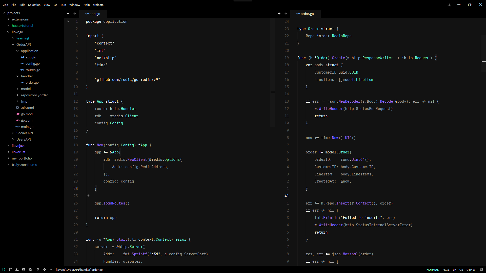
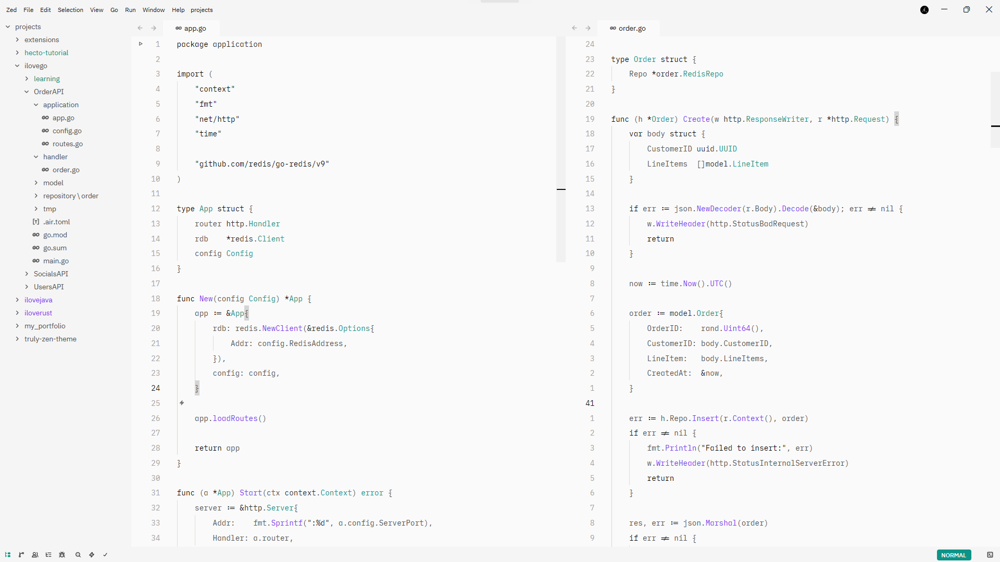

# Truly Zen

A Zed editor theme for total concentration. Dark, minimal, and just a little bit mysterious — with a light side for when the sun insists on existing.



## What's the vibe?

Truly Zen is what happens when you take a pure black canvas and sprinkle in teal accents like digital tea leaves. It's designed to disappear into the background so you can focus on what actually matters: your code.

**The aesthetic (dark):**

- Pitch black backgrounds (`#000000`) because why waste pixels?
- Teal highlights (`#14b8a6`) that pop without screaming
- Soft grey text (`#e5e5e5`) that doesn't strain your eyes at 3am
- Purple functions (`#9d70ff`) because life needs a little color
- Aqua types (`#70ffe5`), white keywords for maximum readability

**And the light side:**

- App chrome at `#f5f5f5`, with the editor one step *lighter* at `#fafafa` so your code floats
- Deep teal accent (`#0d9488`), purple functions (`#7c3aed`), pure black keywords
- Same zen discipline: transparent borders, no cursor-line noise, neutral greys for search matches

**Four flavors included:**

- **Truly Zen Dark** — the classic experience
- **Truly Zen Dark Italics** — same zen, but with italics on `comment`, `keyword`, `link_text`, and `predictive` for extra flow state
- **Truly Zen Light** — the daylight retreat
- **Truly Zen Light Italics** — light, with the same four italic scopes



## Installation

### From the Extension Store

1. Open Zed
2. Press `ctrl+shift+x` (or `cmd+shift+x` on macOS) to open Extensions
3. Search for "Truly Zen"
4. Click Install
5. Select it from the theme selector with `ctrl+k ctrl+t`

### As a Dev Extension (for testing)

1. Clone this repo:
   ```bash
   git clone https://github.com/abhinaaaavvv/truly-zen-theme.git
   ```
2. Open Zed
3. Open the command palette with `ctrl+shift+p`
4. Run `zed: Install Dev Extension`
5. Select the cloned directory
6. Pick your theme from `ctrl+k ctrl+t`

### Manual Installation

1. Copy the theme files you want from `themes/` to:
   - **macOS/Linux:** `~/.config/zed/themes/`
   - **Windows:** `%USERPROFILE%\AppData\Roaming\Zed\themes\`

   The four files are:
   - `truly-zen.json` (Truly Zen Dark)
   - `truly-zen-italics.json` (Truly Zen Dark Italics)
   - `truly-zen-light.json` (Truly Zen Light)
   - `truly-zen-light-italics.json` (Truly Zen Light Italics)

2. Restart Zed
3. Select the theme with `ctrl+k ctrl+t`

## Settings

If you want to set it as your default theme, add this to your `settings.json`:

```json
{
  "theme": "Truly Zen Dark"
}
```

Or for the light version:

```json
{
  "theme": "Truly Zen Light"
}
```

The italics variants are named `Truly Zen Dark Italics` and `Truly Zen Light Italics`.

For dark/light mode switching:

```json
{
  "theme": {
    "dark": "Truly Zen Dark",
    "light": "Truly Zen Light",
    "mode": "system"
  }
}
```

## Color Palette

### Dark

| Element    | Color                      |
| ---------- | -------------------------- |
| Background | `#000000`                  |
| Editor     | `#121212`                  |
| Text       | `#e5e5e5`                  |
| Accent     | `#14b8a6` (teal)           |
| Functions  | `#9d70ff` (purple)         |
| Types      | `#70ffe5` (aqua)           |
| Keywords   | `#ffffff` (white)          |
| Comments   | `#525252` (grey)           |
| Strings    | `#ffffff` (white)          |
| Variables  | `#aaaaaa` (light grey)     |

### Light

| Element    | Color                      |
| ---------- | -------------------------- |
| Background | `#f5f5f5`                  |
| Editor     | `#fafafa` (lighter than the app chrome) |
| Text       | `#171717`                  |
| Accent     | `#0d9488` (deep teal)      |
| Functions  | `#7c3aed` (purple)         |
| Types      | `#0d9488` (teal)           |
| Keywords   | `#000000` (black)          |
| Comments   | `#8c8c8c` (grey)           |
| Strings    | `#000000` (black)          |
| Variables  | `#525252` (grey)           |

## Terminal Colors

The theme includes a full set of terminal colors that match the aesthetic:

- Dark: bright mint green (`#00ffc2`), aqua cyan (`#55ffff`), lemon yellow (`#ffff55`)
- Light: darkened to readable equivalents — green `#00876b`, cyan `#00838f`, yellow `#8a7500`
- Classic reds for errors (obviously), the usual ANSI suspects, all tuned to play nice with their backgrounds

## Contributing

Found a bug? Want to add something? PRs are welcome. Just keep the zen intact.

## License

MIT — use it, modify it, make it your own.

---

_Made with focus in mind. Now go ship something._ ✨
